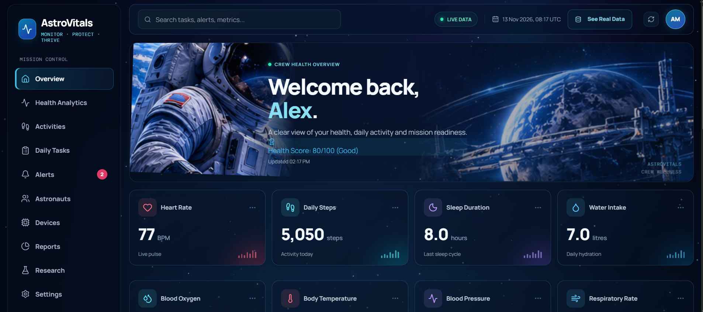
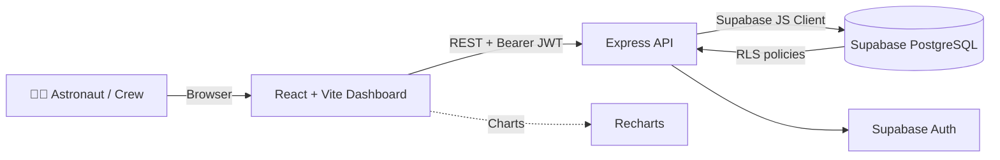

<div align="center">

# 🚀 AstroVital

### Space Mission Health Intelligence System

**Real-time astronaut health monitoring, anomaly detection, and mission readiness, built for the NASA Space Apps Challenge 2026.**

[](https://www.spaceappschallenge.org)
[](https://react.dev)
[](https://www.typescriptlang.org)
[](https://supabase.com)
[](https://vercel.com)
[](#-license)

[**Live Demo**](https://astrovital-web.vercel.app/) ·




</div>

---

## 📑 Table of Contents

- [Overview](#-overview)
- [The Problem](#-the-problem)
- [Our Solution](#-our-solution)
- [Key Features](#-key-features)
- [Architecture](#-architecture)
- [Tech Stack](#-tech-stack)
- [Project Structure](#-project-structure)
- [Getting Started](#-getting-started)
- [Environment Variables](#-environment-variables)
- [API Reference](#-api-reference)
- [Health Score Algorithm](#-health-score-algorithm)
- [Security & Privacy](#-security--privacy)
- [Deployment](#-deployment)
- [Roadmap](#-roadmap)
- [NASA Data Sources](#-nasa-data-sources)
- [Team](#-team)
- [Contributing](#-contributing)
- [License](#-license)
- [Acknowledgements](#-acknowledgements)

---

## 🌍 Overview

AstroVital is a full-stack, mission-critical web application that monitors astronaut health, biometrics, and mission readiness in real time. It pairs an immersive, space-themed interface with a secure Supabase backend to show registered crew members, compute live health scores, and manage daily mission tasks.

> **Challenge category:** *Create Health Monitoring Software for Astronauts on Space Missions*

### Real data, no mock users

| Principle | What it means |
|---|---|
| **Real authentication** | Credentials are hashed and stored in Supabase Auth. There are no hard-coded users. |
| **Live database sync** | Profiles, roles (Mission Commander, Pilot, etc.) and health scores come straight from the `astronaut_profiles` table. |
| **Dynamic scoring** | Health scores are recalculated from the latest biometrics (heart rate, SpO₂, sleep, steps) and the UI updates instantly. |
| **API-driven** | The React frontend talks only to the Express API (`/api/auth`, `/api/dashboard`), which acts as a secure bridge to the database. |

---

## 🛰️ The Problem

Long-duration space missions expose crews to microgravity, radiation, disrupted sleep cycles, isolation, and limited access to medical care. Small physiological changes can go unnoticed until they become serious, and mission teams are often hours away from real-time communication with Earth.

## 💡 Our Solution

AstroVital gives every astronaut and mission lead a single, privacy-aware view of crew health:

1. **Collect** vitals such as heart rate, oxygen saturation, body temperature, sleep, and activity.
2. **Analyze** them with threshold-based anomaly detection.
3. **Score** overall readiness on a simple 0–100 scale.
4. **Alert** the right people when something drifts out of range.
5. **Protect** each crew member's detailed medical data while sharing only the aggregate status.

---

## ✨ Key Features

| | Feature | Description |
|---|---|---|
| 🔐 | **Secure Authentication** | Full login and registration flow powered by Supabase Auth. The dashboard is inaccessible without valid credentials. |
| 👨‍🚀 | **Privacy-First Crew Directory** | Shows every registered astronaut's name, role, badge ID, and overall health score, while keeping detailed vitals private. |
| 📊 | **Real-Time Telemetry** | Interactive Recharts visualizations of heart rate, SpO₂, and activity trends. |
| 🏆 | **Dynamic Health Score** | Automatically evaluates biometrics (for example, a drop when heart rate exceeds 100 bpm or sleep falls below 6 hours) to produce a readiness score. |
| 🚨 | **Anomaly Detection & Alerts** | Threshold-based detection with a notification interface for out-of-range readings. |
| 📈 | **History & Trends** | Visualize how each vital changes over time to spot slow drifts early. |
| 📝 | **Daily Mission Checklist** | Track nutrition, exercise, and health checks. Progress is saved locally and synced. |
| 🌌 | **Immersive Space UI** | Animated canvas background with parallax stars, shooting stars, floating astronauts, and a glassmorphism design. |

---

## 🏗️ Architecture



**Request flow:** the dashboard sends authenticated requests to the Express API, which validates the JWT through Supabase Auth, queries PostgreSQL under Row Level Security, and returns only what the caller is allowed to see.

---

## 🛠️ Tech Stack

<table>
<tr>
<td valign="top" width="25%">

**Frontend**
- React 18 (Vite)
- TypeScript
- Tailwind CSS
- Recharts
- Lucide React
- Custom CSS (glassmorphism, canvas animations)

</td>
<td valign="top" width="25%">

**Backend**
- Node.js
- Express
- TypeScript
- Supabase JS Client
- CORS & Dotenv

</td>
<td valign="top" width="25%">

**Database & Auth**
- Supabase PostgreSQL
- Supabase Auth
- Row Level Security (RLS)

</td>
<td valign="top" width="25%">

**Deployment**
- Vercel (frontend)
- Vercel Serverless (backend)

</td>
</tr>
</table>

---

## 📂 Project Structure

```text
AstroVital/
├── backend/
│   ├── src/
│   │   ├── config/          # Supabase client initialization
│   │   ├── controllers/     # Auth logic (login/register)
│   │   ├── routes/          # Express API routes
│   │   └── server.ts        # Express server entry point
│   ├── .env                 # Backend secrets (never commit)
│   ├── package.json
│   └── tsconfig.json
├── dashboard/               # React frontend
│   ├── src/
│   │   ├── assets/          # Images & icons
│   │   ├── components/      # UI components (AuthModal, CrewPage, etc.)
│   │   ├── services/        # API calls & real-time listeners
│   │   ├── App.tsx          # Main dashboard layout
│   │   └── index.css        # Global styles & Tailwind
│   ├── package.json
│   └── vite.config.ts
└── vercel.json              # Vercel multi-service routing config
```

---

## 🚀 Getting Started

### Prerequisites

- **Node.js** v18 or higher
- **npm** (bundled with Node.js)
- A free **[Supabase](https://supabase.com)** project

### 1. Clone the repository

```bash
git clone https://github.com/nifadhasanh21/AstroVital.git
cd AstroVital
```

### 2. Set up the database

Open the **Supabase SQL Editor** and run the script below. It creates the table, security policies, and a trigger that auto-creates a profile on signup.

<details>
<summary><b>📄 Click to expand the SQL script</b></summary>

```sql
-- Create the Astronaut Profiles table
create table if not exists public.astronaut_profiles (
  id uuid references auth.users on delete cascade not null primary key,
  full_name text,
  email text,
  position text,
  badge_id text,
  age integer,
  height_cm integer,
  weight_kg integer,
  gender text,
  health_score integer default 100,
  created_at timestamp with time zone default timezone('utc'::text, now()) not null
);

-- Enable Row Level Security (RLS)
alter table public.astronaut_profiles enable row level security;

-- RLS policies
create policy "Public profiles are viewable by everyone."
  on astronaut_profiles for select using ( true );

create policy "Users can insert their own profile."
  on astronaut_profiles for insert with check ( auth.uid() = id );

create policy "Users can update own profile."
  on astronaut_profiles for update using ( auth.uid() = id );

-- Trigger: auto-create a profile on signup
create or replace function public.handle_new_user()
returns trigger language plpgsql security definer set search_path = public
as $$
begin
  insert into public.astronaut_profiles (id, full_name, email, position, badge_id)
  values (
    new.id,
    new.raw_user_meta_data ->> 'full_name',
    new.email,
    new.raw_user_meta_data ->> 'position',
    'AST-' || floor(random() * 900 + 100)::text
  );
  return new;
end;
$$;

drop trigger if exists on_auth_user_created on auth.users;
create trigger on_auth_user_created
  after insert on auth.users
  for each row execute procedure public.handle_new_user();
```

</details>

> [!NOTE]
> Disable **Confirm Email** under *Authentication → Providers → Email* so users can log in immediately after registering.

### 3. Run the backend

```bash
cd backend
npm install
cp .env.example .env     # then fill in your Supabase credentials
npm run dev
```

The API starts at **http://localhost:5000**.

### 4. Run the frontend

In a new terminal:

```bash
cd dashboard
npm install
npm run dev
```

The dashboard starts at **http://localhost:5173** (or `:3000`).

### 5. Open the app

Register a new crew member from the **AuthModal**, log in, and your live dashboard is ready.

---

## 🔑 Environment Variables

### Backend (`backend/.env`)

| Variable | Required | Description |
|---|:---:|---|
| `SUPABASE_URL` | ✅ | Your Supabase project URL |
| `SUPABASE_ANON_KEY` | ✅ | Your Supabase anon (public) key |
| `PORT` | ❌ | Server port (default `5000`) |

```env
SUPABASE_URL=your_supabase_project_url
SUPABASE_ANON_KEY=your_supabase_anon_key
PORT=5000
```

> [!WARNING]
> Never commit `.env` files. Make sure `.env` is listed in your `.gitignore`.

---

## 📡 API Reference

All protected routes require the header `Authorization: Bearer <supabase_access_token>`.

| Method | Endpoint | Auth | Description |
|---|---|:---:|---|
| `POST` | `/api/auth/register` | ❌ | Register a new crew member |
| `POST` | `/api/auth/login` | ❌ | Log in and receive a session token |
| `GET` | `/api/dashboard` | ✅ | Fetch dashboard data and the crew directory |

> Adjust this table to match your final route names.

---

## 🧮 Health Score Algorithm

Every astronaut starts at **100**. Penalties are applied based on the latest biometric inputs:

| Metric | Healthy Range | Penalty Trigger |
|---|---|---|
| ❤️ Heart Rate | 60–100 bpm | Above 100 bpm |
| 🫁 SpO₂ | ≥ 95% | Below healthy threshold |
| 😴 Sleep | ≥ 6 hours | Below 6 hours |
| 🚶 Steps / Activity | Daily target | Below target |

The final score is a readiness indicator, not a medical diagnosis. Exact penalty weights live in the dashboard's scoring logic and can be tuned per mission profile.

---

## 🔒 Security & Privacy

- **Row Level Security (RLS):** Users can update only their own profile, while the crew directory can read public profile fields.
- **Data masking:** Other crew members' detailed vitals (heart rate, SpO₂) are hidden. Only the aggregate readiness score is shared.
- **JWT authentication:** API requests are authorized with Bearer tokens issued by Supabase Auth.
- **Hashed credentials:** Passwords are never stored in plain text.
- **Minimal exposure:** The frontend never talks to the database directly; it goes through the Express API.

> [!IMPORTANT]
> AstroVital is a hackathon prototype. It is **not** a certified medical device and must not be used for real clinical decisions.

---

## ☁️ Deployment

The repository is a monorepo. `vercel.json` routes traffic between the React frontend and the Express serverless backend.

1. Push your code to GitHub.
2. Import the repository into **[Vercel](https://vercel.com)**.
3. Add these environment variables in **Project Settings**:
   - `SUPABASE_URL`
   - `SUPABASE_ANON_KEY`
4. Apply them to **Production**, **Preview**, and **Development**.
5. Click **Deploy**. Vercel builds the backend functions and the static frontend.

---

## 🗺️ Roadmap

- [x] Authentication and crew directory
- [x] Real-time telemetry dashboard
- [x] Dynamic health score
- [x] Daily mission checklist
- [x] Privacy-first data masking
- [ ] Integration with NASA OSDR datasets
- [ ] Wearable and sensor streaming (WebSockets)
- [ ] Predictive health analytics with machine learning
- [ ] Mission-commander view with crew-wide alerts
- [ ] Push and email notifications
- [ ] Offline-first mode for communication delays
- [ ] Exportable health reports (PDF)

Have an idea? [Open an issue](../../issues).

---

## 🛸 NASA Data Sources

AstroVital is designed around open NASA data, including the **[NASA Open Science Data Repository (OSDR)](https://osdr.nasa.gov)**, to ground thresholds and future analytics in real spaceflight research.

---

## 👥 Team

**Team DIU Corvex**, aspiring software developers from Daffodil International University, Bangladesh.

| Name | Role | GitHub |
|---|---|---|
| Nifad Hasan Eimu| Team Lead / Full-Stack Developer | [@nifadhasanh21](https://github.com/) |
| Safwan Sahat | UI/UX Designer | [@SafwanSahat](https://github.com/) |
| Amrina Rahman | App Developer | [@amrina-rahman](https://github.com/) |
| Israt Jahan | Frontend Developer | [@israt-158](https://github.com/) |


Team page: [spaceappschallenge.org](https://www.spaceappschallenge.org)

---

## 🤝 Contributing

Contributions are welcome.

1. Fork the project
2. Create your branch: `git checkout -b feature/amazing-feature`
3. Commit your changes: `git commit -m "Add amazing feature"`
4. Push to the branch: `git push origin feature/amazing-feature`
5. Open a Pull Request

---

## 📝 License

Built for the **NASA Space Apps Challenge**. Distributed under the **MIT License** for educational use. See [`LICENSE`](LICENSE) for details.

---

## 🙏 Acknowledgements

- [NASA Space Apps Challenge](https://www.spaceappschallenge.org) for the opportunity
- [NASA OSDR](https://osdr.nasa.gov) for open science data
- [Supabase](https://supabase.com), [Vercel](https://vercel.com), [Recharts](https://recharts.org), and [Lucide](https://lucide.dev)

<div align="center">

**Built with ❤️ for the future of human spaceflight.**

⭐ If you like this project, give it a star!

</div>
